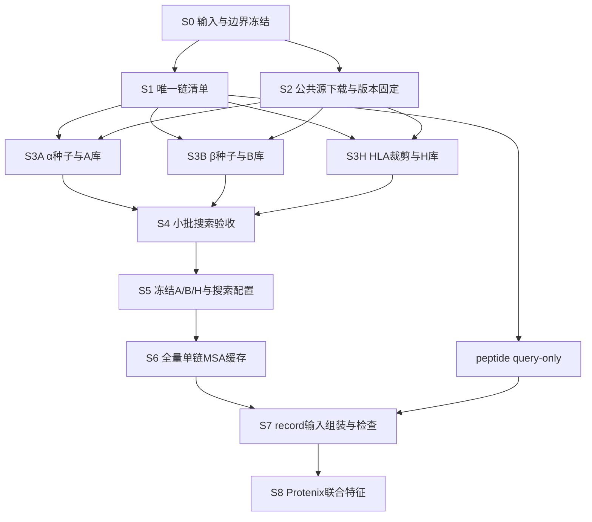

> 历史文档（2026-11-03）：MSA 建库与搜索脚本已从仓库移除，以下命令不再作为当前操作入口；保留本文用于追溯实验方法。

> 2026-10-08 用户要求的当前重构覆盖本计划旧版的 SHA/哈希缓存键/peptide 文件/冗余标准 JSON/代码快照要求：现使用稳定链 ID、精确序列与显式配置，脚本位于 `scripts/MSA_building/`。当前接口与验收边界见 [存储与数据流说明](TMP_MSA_STORAGE_AND_DATAFLOW.md)。下文相关旧要求仅保留为计划历史。

# TMP-Prediction：A/B/H 搜索库构建与 MSA 搜索执行方案

- 日期：2026-10-07
- 仓库：cyan741/FoldAbs_Tm_MSA
- 目标分支：tmp-specificity
- 状态：方案与验收定义；脚本入口、当前执行状态和已实测结果见 [建库执行记录](TMP_ABH_DATABASE_BUILD_USAGE.md)。后续步骤是否完成以该记录和实际产物为准。

## 1. 固定方案与边界

1. A 库用于 TCRα，B 库用于 TCRβ，H 库用于 HLA-I；H 明确指 HLA，不是抗体 heavy。
2. TCRα、TCRβ、HLA 分别提供 unpaired MSA；不设置 pairedMsaPath。
3. peptide 不搜索，只写 query-only A3M。
4. A/B 库采用“训练集代表种子 → 固定版本母库搜索 → 汇总命中 → 清洗去重”的紧凑库方法。
5. H 库先采用固定版本公共 HLA-I 蛋白参考序列，按实际输入区域裁剪并去重；必要时再补充公共母库中的 MHC-I 同源序列。
6. 保留已经确定的 Hi-TPH peptide 分组划分，不重新划分。验证/测试序列不参与 A/B 种子选择、数据库补充或扩库决策。
7. 当前负样本方案为正:负=1:2，验证/内部测试固定，训练动态采样。负样本构造独立执行；单链 MSA 可以复用，新四链组合的 Protenix 联合特征必须单独提取。
8. 训练动态采样的实现需与已缓存候选负池协调：不能假设任意新组合都有现成联合特征。本文不改变已有负样本执行策略。
9. 外部测试只查询冻结数据库，不用于选择 MSA 参数、数据库版本或模型配置。

## 2. 原 repo 的可复用部分及现状

| 文件 | 已有行为 | TMP 迁移要求 |
|---|---|---|
| scripts/MSA_building/build_compact_nb_msa_database.py | 从 NbThermo 选默认200条纳米抗体种子，读取已有 A3M，去 gap、插入转大写、精确去重 | 更换输入字段、种子规则；新增 A/B 分库及来源追踪 |
| scripts/MSA_building/prepare_compact_db_msa_cache.py | 唯一序列本地 jackhmmer；Stockholm 转 A3M；写 unpairedMsaPath | 按 A/B/H 路由；peptide 跳过；缓存键纳入库版本和参数 |
| scripts/MSA_building/extract_protenix_local_msa_only.py | 验证本地 A3M 查询与输入匹配；拒绝 pairedMsaPath；阻断远程搜索回退 | 可用于最终本地 MSA 输入验收，所有链均需提供 A3M，包括 query-only peptide |

现有纳米抗体脚本的种子距离为 0.8×3-mer Jaccard 距离 + 0.2×归一化长度差，默认每个种子取前1000行 A3M（包含查询行），不是严格1000条完整同源蛋白。

docs/MSA_ACCELERATION_CORRECTION_PLAN.md 记录已有22,198条库来自 ColabFold 缓存聚合，应称 compact proxy；从固定版本完整 UniRef50 搜索后建库是后续路线。已有代理库不直接用于 A/B/H，也不改名为 UniRef50 派生库。

原建库脚本不执行种子的大库搜索。A3M 去 gap 后得到的可能是比对片段；若需要完整命中蛋白，应另外保留 accession 并从母库回取原始序列。本文优先保留 accession 和来源，以便审计。

## 3. 数据源及需要固定的版本

| 来源 | 获取位置 | 用途 |
|---|---|---|
| UniRef50 | https://ftp.uniprot.org/pub/databases/uniprot/uniref/uniref50/ | A/B 默认母库，下载 FASTA 和 release note |
| UniRef90（可选） | https://ftp.uniprot.org/pub/databases/uniprot/uniref/uniref90/ | 后续验证覆盖不足时可比较，不直接替代主设置 |
| IMGT TR 参考 | https://www.imgt.org/about/downloads.php | V/J 注释、种子覆盖检查；注意下载核酸/蛋白格式 |
| IPD-IMGT/HLA | https://www.ebi.ac.uk/ipd/imgt/hla/download/ | HLA 蛋白参考 |
| IMGTHLA 官方镜像 | https://github.com/ANHIG/IMGTHLA | 通过指定 release 分支/commit 获取 hla_prot.fasta 和版本文件 |

必须记录 source_url、release、下载日期、SHA256、原始条数及残基数。不可使用浮动 Latest 而不记录对应 commit。

IMGT 胚系 V/J 片段不能替代包含重排 CDR3 的完整 TCR 可变区库。公共 HLA 等位基因深度也不能直接等同于进化多样性。

## 4. 执行依赖和并行顺序



- S1 与 S2 可并行。
- S3A、S3B、S3H 可并行；A/B 共用母库，不复制下载文件。
- peptide query-only 生成、负样本候选池构造可与建库并行。
- 冻结配置后，A/B/H 全量查询可并行分片。
- MSA 工作主要用 CPU；GPU 可处理已经通过验证的完整 record，但正式全量特征应等待配置冻结。
- 并行受 CPU、内存和磁盘带宽限制。不要让每个进程都占满所有 CPU；同时多次扫描母库可能受磁盘瓶颈限制。

## 5. S0—S1：冻结输入、生成唯一链清单

输入：清洗后的正例表、固定 split manifest、外部评测输入、四链构建规则。

执行：
1. 明确 TCRα/β 输入是完整可变区还是其他边界；本计划按实际四链输入的精确序列建库和查询。
2. 明确 HLA 输入裁剪规则和参考编号。若采用连续 α1/α2 clip，固定起止和映射。
3. 若输入为非连续位点拼接的伪序列，先实现参考位置到输入列的映射；不能给该序列直接挂全长 HLA MSA。列映射未验收不得进入正式搜索。
4. 清理空白和大小写；异常残基进入隔离表，禁止无记录删除残基改变输入。
5. 按角色、精确氨基酸序列去重；保留所有 record 引用关系。

产物：
- unique_A.tsv、unique_B.tsv、unique_H.tsv、unique_peptide.tsv
- record_chain_map.tsv
- input_sequence_spec.json
- input_audit.json

唯一链字段：chain_role、sequence_sha256、sequence、length、split_membership、record_count；H 另保留 allele 列表及 clip_spec_id，A/B 可附 V/J/CDR3 注释及可信度。

同一序列可以同时出现于多个 split，MSA 只计算一次。这不等于修改或重新保证 TCR-disjoint 划分；重叠情况应另行汇报。

验收：每条 record 映射到四条精确输入序列；数据库构建的 A/B 种子候选只来自 train。

## 6. S2：准备母库与公共 HLA 参考

执行：
1. 下载固定 release 的 UniRef50 FASTA 与 release note；检查完整性和 SHA256，记录解压后的规模。
2. 下载指定 release/commit 的 hla_prot.fasta、release 信息及参考比对。
3. 准备 HMMER/jackhmmer 环境，记录可执行路径和版本。
4. IMGT 注释参考可单独下载并准备，A/B 大库搜索不必等待非必需注释。

产物：sources_manifest.json、tool_versions.json、固定版本原始数据文件。

运行资源采用实测估算，不以既往纳米抗体实验速度估算全量 TCR 时间。

## 7. S3A/S3B：构建 A/B 紧凑库

### 7.1 选择代表种子

1. 使用 train 唯一 A/B 链，各自独立选择。
2. 有可靠注释时覆盖 V 家族/基因、J 使用、CDR3 长度和序列多样性。
3. 无可靠注释时，按全可变区聚类或采用序列多样性选择，并明确其近似性质。
4. 小批从每库约50条种子起步；在训练集覆盖检查上逐步扩展到100/200等规模。这是工程起点，不是已验证最佳值。
5. 用未作种子的 train 查询检查覆盖，不使用 val/test 扩库；稀有类型应纳入抽查。

产物：A_seeds.tsv、B_seeds.tsv、seed_selection_report.json。包含选择理由、种子参数、数据 manifest hash；不使用结合标签强弱选择种子。

### 7.2 搜索母库

每个种子运行 jackhmmer，初始参数：
- iterations=1
- E-value=1e-3，inclusion E-value=1e-3
- CPU 线程数按主机预算分配
- pilot 阶段保留 Stockholm、命中表和日志

命令模板（路径由实际配置替换）：

```bash
jackhmmer --cpu 4 -N 1 -E 1e-3 --incE 1e-3 \
  --noali -A seed.sto --tblout seed.tbl --domtblout seed.domtbl \
  seed.fasta uniref50.fasta > seed.log
```

上述是现有工具的命令模板，不代表已经执行。母库/小库规模改变会影响 E-value；保留原始 bit score、覆盖率等供诊断，不能把同阈值视为完全等价。

### 7.3 汇总、清洗与去重

1. 汇总命中及 accession、来源种子、分数和覆盖率；优先能回取原序列的结果。
2. 若使用 A3M 片段汇总，去 gap、保留小写插入残基并转大写；标记 fragment 来源，禁止写成完整蛋白。
3. 过滤非标准残基、低覆盖、明显不相关链或异常长度；初始覆盖阈值可设查询的70%，属于待 pilot 确认的工程设置。
4. 检查 A/B 命中链类型。Ig-like 结构域相似不保证是同类 TCR；无法确定的命中保留标记并抽查。
5. 精确序列去重。第一版不强制95%聚类压缩，以免过早丢失信息。
6. 不直接截取文件最前1000行代表多样性；如需限制规模，按覆盖、质量、冗余与序列多样性选择并记录。
7. 保留相同序列的多来源映射，即使 FASTA 中仅保留一条。

产物：A_compact.fasta、B_compact.fasta、A/B_provenance.tsv、A/B_build_report.json。

验收：无重复序列、无空序列、来源可追溯；报告 train 查询覆盖、长度分布、库残基数、无法确认链类型比例。

## 8. S3H：构建 HLA 紧凑库

执行：
1. 从固定 IPD-IMGT/HLA release 筛选实际范围内的 HLA-I 位点；若仅纳入 HLA-A/B/C，排除其他位点和 HLA-II。
2. 依据参考比对/编号裁剪与模型输入相同的区域；不能对不同全长记录机械使用同一数组下标而忽略缺失与插入。
3. 排除未完整覆盖目标区域的序列及异常序列，输出排除理由。
4. 对裁剪后精确序列去重；保留全部 allele-to-sequence 映射。
5. 对唯一 HLA 查询搜索 H 库并缓存。
6. pilot 若显示去重后多样性很低，再由公共参考 HLA 代表序列搜索母库补充 MHC-I 同源；清洗与版本重新冻结后重做 pilot。

产物：H_hla_compact.fasta、H_allele_sequence_map.tsv、H_provenance.tsv、H_build_report.json。

不能用行数多来证明 H MSA 信息丰富；必须检查冗余和有效多样性。HLA 唯一查询较少时，直接大库搜索一次并缓存也可作参考对照。

## 9. S4—S5：小批验收与配置冻结

每类取覆盖常见/稀有类型的查询（建议20—50条），其中 A/B 主覆盖诊断来自未作种子的 train。比较母库和紧凑库，尽量固定工具与参数。

记录：
- 一次性下载/建库时间，逐条检索时间、失败数
- query-only 比例、匹配覆盖率、非 gap 比例
- 原始深度、精确去重深度、相似性加权有效序列数（Neff，报告定义）
- 重复命中、异常/错误链类型比例
- 相同 Protenix/head 设置的验证表现及特征耗时

数据库内容扩展只由 train 覆盖诊断及公共参考决定。val 可用于选择预先设计的 MSA 配置，外部 test 不用于选择；避免反复依据 val 单个查询扩库。

发现大量 query-only/低覆盖：先核对输入边界和搜索阈值，再在训练集内增加种子或比较母库版本。
发现高度冗余：评估多样性选择和最大深度限制，不能仅继续增加相同等位基因。

冻结产物：database_manifest.json、msa_config.json、pilot_report.tsv。记录所有文件 hash、阈值、max_hits、工具版本和输入边界。第一版不预设加速倍数或性能等价。

## 10. S6：全量 MSA 搜索与缓存

### 10.1 路由

| chain_role | 动作 | 库 |
|---|---|---|
| tcr_alpha | jackhmmer → Stockholm → A3M | A |
| tcr_beta | 同上 | B |
| hla | 同上 | H |
| peptide | 直接 query-only A3M | 不搜索 |

只有完整数据库与配置冻结后，才启动正式全量缓存。对全部 split/外部输入的唯一链查询冻结库；不将查询结果反向追加进搜索库。

### 10.2 缓存键与断点续跑

cache_key = SHA256(role + sequence + database_hash + msa_config_hash + tool_version + input_spec_hash)。

不可只按序列 hash 判断新版缓存有效。manifest 至少包括：
chain_role、sequence、sequence_sha256、database_id/hash、config_hash、a3m_path/hash、
raw_depth、deduplicated_depth、coverage_summary、elapsed_seconds、status、failure_reason。

同配置已有有效条目复用；文件存在不代表成功。先写临时文件，验证后原子替换；分片使用独立 manifest，完成后归并，避免多个 worker 覆盖同一文件。

### 10.3 A3M 验证

1. 第一行序列等于实际输入查询，且查询本身无 gap。
2. 每条命中移除小写插入字符后，匹配列数等于查询长度；gap 保留在匹配列。
3. 转换正确处理 Stockholm 的 gap 表示（包括查询插入列的 "." 等情况），通过人工可判定的短比对例验收；不要原样假定现有仅识别 "-" 的转换已覆盖所有输出。
4. 无异常残基、空序列和重复命中。
5. peptide 恰好一条序列：
```text
>query
LLFGYPVYV
```
6. 无命中时保存 query-only 并标记 no_hit；搜索报错不能静默当作 no_hit。

全量失败项单独补跑；不允许自动回退远程搜索而不记录。

## 11. S7—S8：组装 record 并形成联合特征

1. 用 record_chain_map 为四链 JSON 写入绝对 unpairedMsaPath。
2. 保持现有四链顺序与链角色对应；role 元数据可保存在 sidecar，不随意添加未支持的 Protenix 字段。
3. 不设置 pairedMsaPath；peptide 引用 query-only 文件。
4. 对正负样本采用同一搜索设置。
5. 在 GPU 提取前检查每条链的精确查询、路径和 hash，使用 extract_protenix_local_msa_only.py 的本地约束。
6. 同一 TCR/HLA 出现在多个组合时复用单链 MSA；不同 peptide/TCR 四链组合重新运行 Protenix，不能拼接单链 embedding 替代联合 s/z/p_dist。
7. 特征缓存目录/键包含四链序列、checkpoint、cycles、dtype、MSA/config hash、代码版本等。
8. pilot 测量单条 GPU 耗时和 .pt 体积后再估算全量容量；不同配置不得依赖旧的 --resume 检查混用缓存。

本地 MSA 接口参考：https://github.com/bytedance/Protenix/blob/main/docs/infer_json_format.md

## 12. 待实现脚本与交付顺序

下表保留最初的接口规划。当前 S0–S5 建库、检索、转换、验收、benchmark 和 shell runner 已实现并执行；正式全量缓存和 record 接入尚未完成。脚本用法及实际缺口以 [建库执行记录](TMP_ABH_DATABASE_BUILD_USAGE.md) 为准。

| 优先级 | 建议文件 | 输入 → 输出 |
|---|---|---|
| P0 | export_tmp_unique_chains.py | 固定记录/split/边界 → 唯一链及映射 |
| P0 | select_tmp_msa_seeds.py | train A/B → 分层代表种子 |
| P0 | select_tmp_msa_seeds.py search | 种子+母库+参数 → 比对及命中来源 |
| P0 | build_tmp_compact_databases.py | A/B 命中 → 清洗去重库和报告 |
| P0 | build_tmp_compact_databases.py hla | 固定 HLA release+边界 → H 库及 allele 映射 |
| P0 | prepare_tmp_msa_cache.py | 唯一链+角色+冻结库 → 分片 A3M 缓存 |
| P0 | prepare_tmp_msa_cache.py validate | manifest+A3M → 查询/列长度/版本检查报告 |
| P1 | attach_tmp_msa_paths.py | record 映射+缓存 → Protenix JSON |
| P1 | run_tmp_abh_build.py report | pilot 结果 → 时间/覆盖/多样性对照 |

实现顺序：先完成输入导出与边界检查；A/B 种子、H 构建可并行；实现统一检索/转换/验收；pilot；冻结；全量；组装；联合特征。

产物根目录固定为 `/NAS/luyq/TMP_prediction/msa_db/v1/`（原始库和大缓存不要提交 Git）。以下路径相对于该根目录，仓库 `data/tmp_msa` 仅保留兼容符号链接：
- inputs/
- sources/、tools/
- seeds/、seed_searches/
- databases/abh_v1/
- pilot/（当前已生成）、cache/<config_id>/A/、B/、H/、peptide/（正式全量待生成）
- records/（待生成）
- reports/

## 13. 完成标准

- [ ] 输入边界、split、外部数据用途固定，A/B 种子仅来自 train。
- [ ] A/B/H 库来源、release、SHA256、过滤和去重规则完整。
- [ ] H 输入为 clip 或伪序列的列映射已明确且验收。
- [ ] A/B 覆盖和 H 多样性完成 pilot；报告一次性建库成本及查询成本。
- [ ] 全量唯一链 MSA 有可靠缓存键、查询匹配、列数检查和失败分类。
- [ ] peptide 搜索次数为0；所有 peptide 为 query-only。
- [ ] JSON 不含 pairedMsaPath；本地验收通过，无意外远程回退。
- [ ] 正负 record 复用单链 MSA，但四链联合特征独立计算。
- [ ] 未将旧 ColabFold 纳米抗体代理库冒充 UniRef 派生 A/B/H 库。
- [ ] docs 中区分已实现、待实现与实测结果，不把计划参数写成已验证结论。
