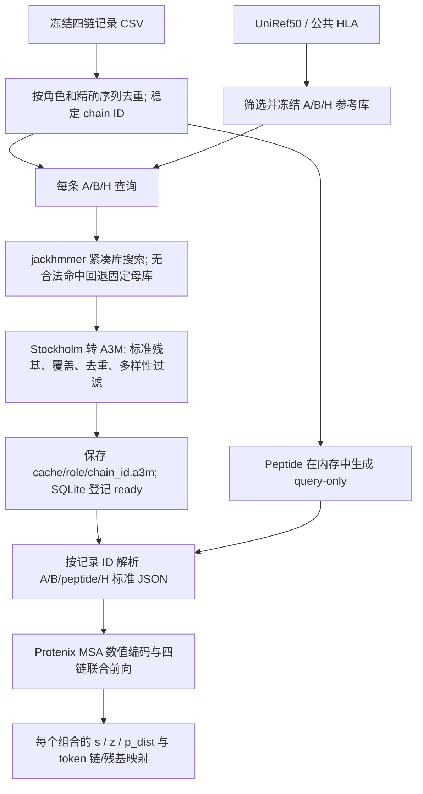

> 历史文档（2026-11-03）：MSA 建库与搜索脚本已从仓库移除，以下命令不再作为当前操作入口；保留本文用于追溯实验方法。

# 当前 TMP MSA 存储与数据流

2026-10-08 按用户要求重构：脚本集中到 `scripts/MSA_building/`；正式缓存路径改为 role/chain ID；删除自行生成的 SHA 字段与标题；记录只存四链 ID；peptide MSA 在内存中生成。对齐序列与搜索协议保持一致。

```text
/home/luyq/FoldAbS_Tm_MSA/scripts/MSA_building/
├── hitph_msa.py                      index / append：链 ID 与索引
├── freeze_hitph_msa.py               audit / freeze：ANARCI 审计及配置冻结
├── cache_hitph_msa.py                cache / ensure：搜索缓存及输入解析
├── extract_hitph_features.py         身份校验及四链特征提取
├── validate_hitph_full_msa.py        msa / features：MSA 与张量验收
├── run_hitph_full_msa.sh             HiTPH 流程入口
└── README.md                        完整逐脚本清单及旧入口映射
```

仓库 `data/tmp_msa` 仍链接到 `/NAS/luyq/TMP_prediction/msa_db/v1`。旧 NAS `data/tmp_msa/sources` 独立重复来源已删除；原始 UniRef50 与公共 HLA 文件、第三方工具仍保留。NAS 不再保存本项目脚本快照；本项目脚本以仓库 `scripts/MSA_building/` 为准。第三方 HMMER/ANARCI 自带程序属于工具安装内容。

## 输入表示与接口

`record_chain_map.tsv` 地址：`/NAS/luyq/TMP_prediction/hitph_msa/inputs/record_chain_map.tsv`。

精简 JSON 的顶层保存一次 `msa_root` 和链顺序，records 中每条形如：

```json
{"name":"L4_0000001","chains":["A00000001","B00041112","P00000001","H00000001"]}
```

该格式是本项目索引接口，不能直接交给原生 Protenix。`load_inputs()` 查 SQLite 取得精确序列及 A/B/H 本地 A3M 路径，生成临时标准 JSON。Peptide 用 `unpairedMsa: ">query\nSEQUENCE\n"`，不创建磁盘 A3M。当前 Protenix 搜索预处理只检查路径，对 inline MSA 会误判为需要搜索；本地提取入口验证已有输入后直接进入特征器，跳过搜索预处理。



## 搜索与转换协议的出处

`TMP_HITPH_FULL_MSA_CACHE_PLAN.md` 第 8 节继承 jackhmmer `-N 1`、E/incE=0.001、seed=42、非 query 覆盖≥70%、最多512条非 query、多样性选择。第一代执行计划第 7 节明确 70% 是需要 pilot 检查的工程起点。它们不是 HMMER/Protenix 的强制格式，也不保证最优；精确参数以当前配置为准。

jackhmmer 第一轮从单条 query 搜索序列库；多轮才把合格命中对齐成 profile 并重复搜索。当前 N=1。原始输出为 `alignment.sto`、命中表、域表和日志；本项目转换器以 query 非 gap 列定义 match 列，对这些列的大写残基/gap 保留，对 query 插入列的残基转小写并省略插入 gap，首行写完整 query。

过滤规则：只接受标准20种残基及 gap；异常行整体排除，不修改残基；按转换后的完整 A3M 行精确去重；非 query match 列非 gap 数 / query 长度≥0.7；超过512条时进行 farthest-point 选择。其距离为 `1 - 相同非gap位点数 / max(两行非gap数)`，先保留 query，每次选与已选集合距离最远的行。没有额外按80% identity硬聚类去重；80%用于 Neff 邻居诊断。CDR3覆盖另行统计，整链覆盖不保证 CDR3 充分覆盖。

## 参考库筛选的含义

A/B 母库以及 H 补充来源都是 `msa_db/v1/sources/uniref50/uniref50.fasta`，锁定发布2026_03。公共 HLA 是 IPD-IMGT/HLA 3.65.0 的蛋白和公共对齐文件；H 库优先公共来源，再加入符合条件的母库同源片段。

ANARCI 以受体 profile 为氨基酸序列分类、IMGT编号，并给出可变域范围；当前 bit threshold=80。A/B参考候选要求类型对应、编号域≥80 aa、最小编号≤10、最大编号≥104、框架位置覆盖≥70%，再按真实源索引裁剪。框架位置为1–26、39–55、66–104、118–128。这些规则限制明显截短和错链，不能确认抗原特异性，也不把 HMM 物种标签当作权威物种证明。

H 连续片段映射是确认输入 HLA clip 精确对应来源蛋白的一段连续区间，再用公共对齐坐标取得同一区域。MHC-I profile 复核由64条确定性抽取的182列公共参考建立 HMM，检查母库补充片段的域分数≥50 bits、profile覆盖≥70%、E≤0.001，并排除明确错类。最终公共参考15,783条，母库补充接受2,374条，共18,157条。它支持结构域同源性，不等价于确认每条补充的 allele/locus/species。

## 状态与验证边界

`index/msa_manifest.sqlite` 的 `chains.status`、`failure_reason`、`attempts`、`search_source`、`metrics_json` 保存查询结果；`events` 保存状态转移。无命中成功结果为 `ready_query_only`，原因在 `metrics_json.result_reason=no_hit_after_fallback`；搜索失败为 `failed_search`，转换失败为 `failed_conversion`。JSON导出和 `pending/chains.tsv` 提供可读状态；阻塞记录另有报告。

移除 SHA 后仍检查完整 query、合法字符、match 列数、去重、深度、覆盖、角色、记录映射和显式配置。**不再检测任意非 query 合法字符被修改但仍满足结构规则的情况，也不提供文件字节级一致性证明。** 来源版本、accession、坐标、搜索分数与实际对齐仍保留。

113,367条查询的完成数量应在迁移后重新验收；蛋白 A3M 文件数为111,061，2,306条peptide保留索引并用内存MSA。85,200条正例的联合特征仍只完成六条真实pilot；全量估计约5.22 TiB，尚未生成。
